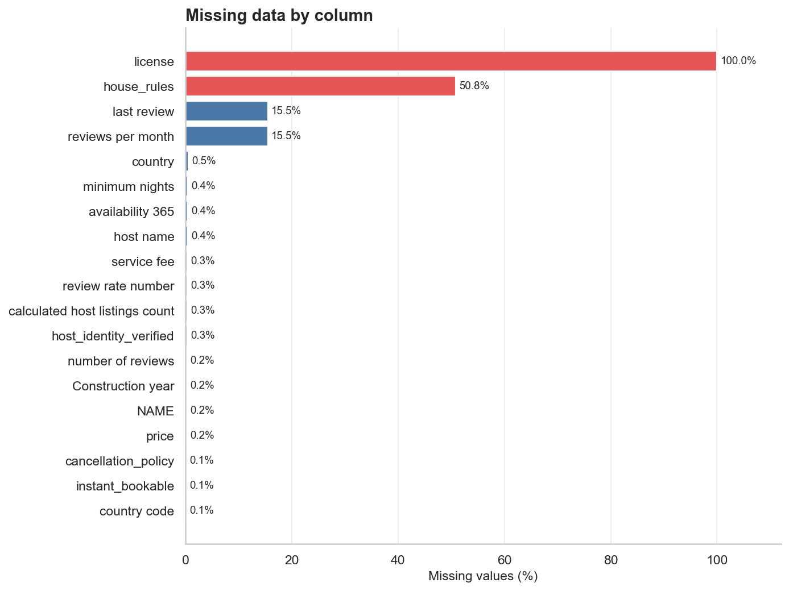
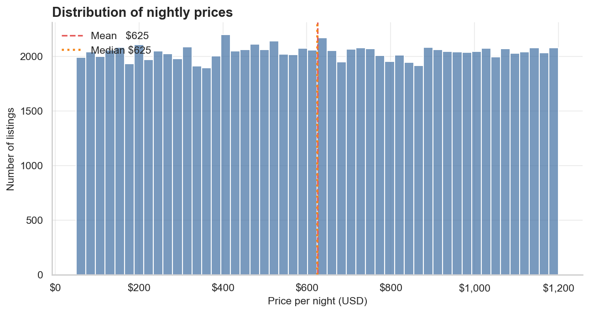
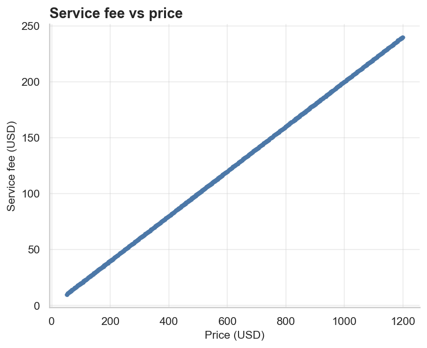
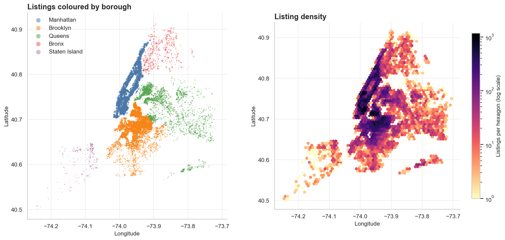
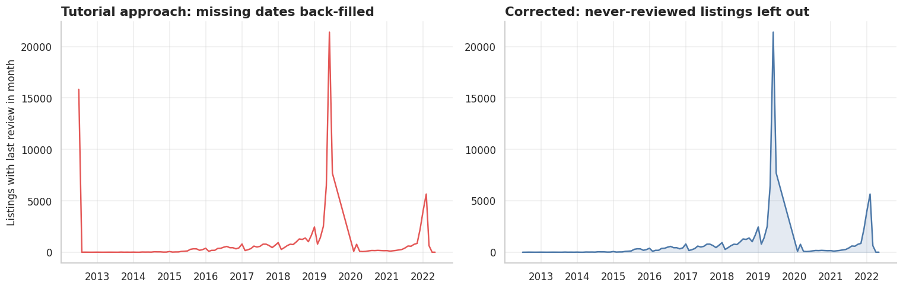
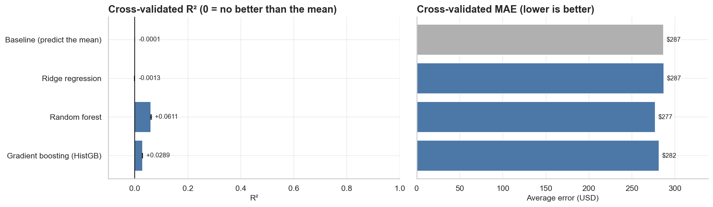
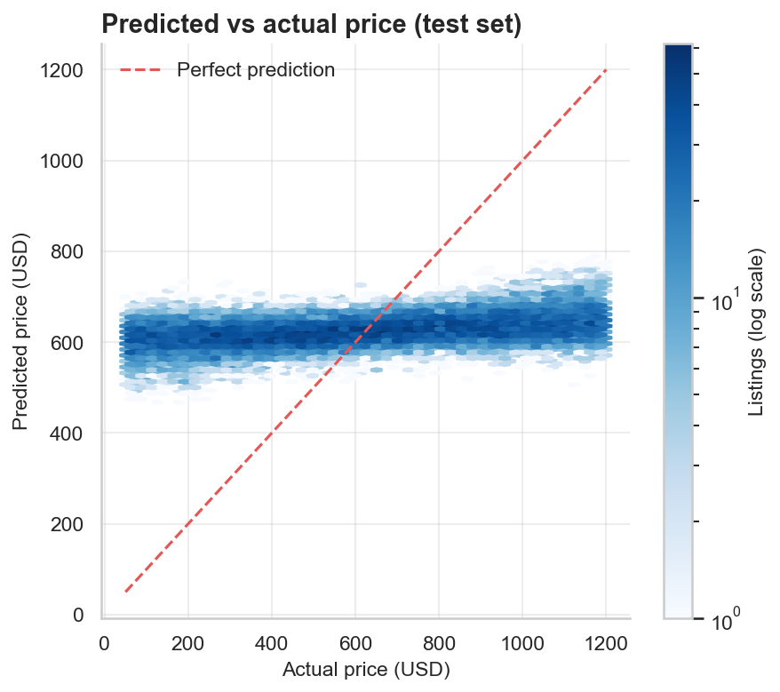
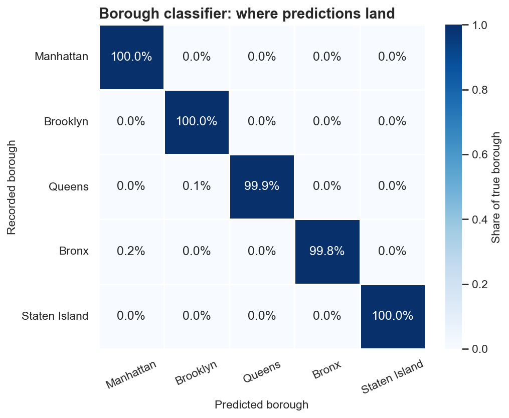

# NYC Airbnb: Cleaning, EDA & Modeling

A data-quality-first analysis of ~102k New York City Airbnb listings. The headline result is a negative one, and the notebook treats it as a finding rather than something to tune away: **price in this dataset looks synthetic and cannot be predicted from the listing features.**

**Included:** `compressed_data.csv` (102,599 rows, 26 columns), 16 exported figures, and the corrected notebook. This is separate from my [NYC Airbnb 2024 EDA project](https://github.com/Talhax55z/Air-BNB-1).

**Notebook:** [`Airbnb_NYC_EDA_and_Modeling.ipynb`](Airbnb_NYC_EDA_and_Modeling.ipynb) (outputs are saved, so it renders on GitHub)

## Key findings

| # | Finding |
|---|---|
| 1 | **Cleaning:** 102,599 raw rows → 102,058 (541 exact duplicates removed, 0.53%). Every row-dropping step is logged. |
| 2 | **Never-reviewed listings:** 15,832 listings (15.5%) have no review. Back-filling their dates with the earliest date, as many tutorials do, piles 15,837 listings onto July 2012 and fakes a spike. Here they stay missing. |
| 3 | **Price looks synthetic:** values run $50–$1,200 and the histogram is almost perfectly flat (skewness ≈ 0). Real listing prices are right-skewed. |
| 4 | **Data leakage caught:** `service_fee` is exactly 20% of `price` (R² = 1.0000 if used as a feature), so it is excluded from every model. |
| 5 | **Price is barely predictable:** the best model reaches test R² ≈ 0.08. Location, room type and the other categorical columns have negligible effect sizes (Kruskal–Wallis with epsilon-squared). |
| 6 | **Borough from lat/long:** ~100% out-of-fold accuracy vs 42.7% for always guessing the biggest borough. This is a sanity check on the coordinates, not a discovery. |

### Price models (held-out test set, 20,363 rows)

| Model | Test R² | Test MAE |
|---|:---:|:---:|
| Baseline (predict the mean) | 0.000 | $287 |
| Ridge regression | -0.001 | $287 |
| Random forest | **0.080** | **$274** |
| Gradient boosting (HistGB) | 0.038 | $281 |

The random forest is about 4% better than the baseline in MAE. The notebook flags this as a weak signal and does not read anything into which features produce it.

## What it does beyond a standard tutorial walkthrough

The notebook starts from a typical cleaning and EDA walkthrough and extends it. Sections are tagged **[Tutorial-based]** or **[Extension]**.

- Validity checks: impossible `minimum_nights` and `availability_365` values and five review dates in 2024–2058 are set to missing, not zero. Misspelled boroughs are fixed with fuzzy matching.
- Feature engineering: haversine distance to Times Square, listing-title length, review recency.
- Spearman correlations, a distance-to-center analysis, and host concentration (14% of listings belong to hosts with 5+ listings).
- Statistical testing with effect sizes, since with ~100k rows almost any difference is "significant".
- A leakage check first, then four models benchmarked against a baseline with 5-fold CV and a held-out test set.
- Permutation importance, and a borough classifier used as a label-quality check.

## Run it

```bash
git clone https://github.com/Talhax55z/airbnb-nyc-eda-modeling.git
cd airbnb-nyc-eda-modeling
python -m venv .venv
# Activate .venv before installing dependencies.
python -m pip install -r requirements.txt
jupyter lab Airbnb_NYC_EDA_and_Modeling.ipynb
```

1. Clone `https://github.com/Talhax55z/airbnb-nyc-eda-modeling.git` and open its directory.
2. Install the dependencies in a virtual environment and open `Airbnb_NYC_EDA_and_Modeling.ipynb`. The supplied `compressed_data.csv` is already next to it.
3. Restart the kernel and run all cells. Random-forest cross-validation and permutation importance can take several minutes. With `SAVE_FIGS = True`, the notebook writes charts to `figures/`.

Dataset reference: [Airbnb Open Data on Kaggle](https://www.kaggle.com/datasets/arianazmoudeh/airbnbopendata). The loader also accepts `Airbnb_Open_Data.csv` or either filename inside `data/`.

## Figures

The supplied chart exports are included below. The review-date figure has been synchronized with the corrected notebook’s saved output. The notebook retains its later corrections to review-date cleaning and interpretation of model results; the older local notebook was not used to overwrite them. Re-running the notebook regenerates the charts from the included dataset.










[Browse all 16 figures](figures).

## Limitations

- Prices are synthetic, so every price-related result describes this file, not real NYC listings. For real analysis, start from [Inside Airbnb](http://insideairbnb.com/get-the-data/), which includes bedrooms, bathrooms, amenities and host history.
- Next steps: model `log(price)` on real data, add TF-IDF features from listing titles, use spatial cross-validation, and trace where the random forest's weak signal comes from.

Developed with Python 3.14, pandas 3.0, scikit-learn 1.8, seaborn 0.13.
